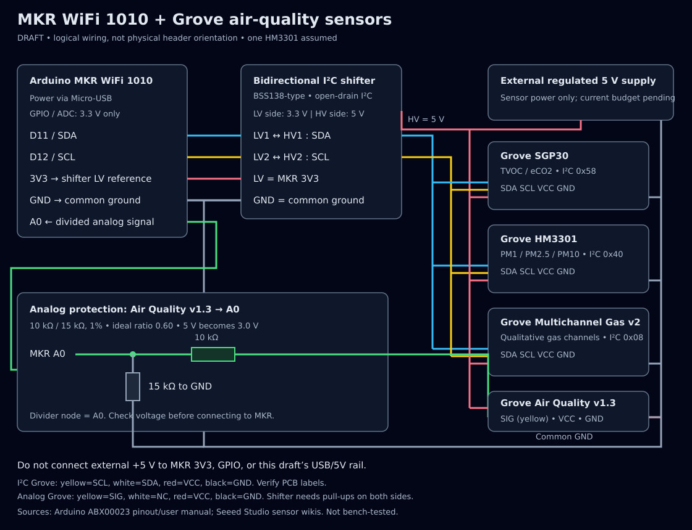

# AeroQualPro — Air Decarbonation

Public research snapshot of an air-quality sensing prototype.

**Status: DRAFT / NOT BENCH-TESTED.** No measured sensor dataset, working integrated firmware, carbon-removal result or calibrated gas measurement is claimed.

The repository name includes `esp`, but the controller selected in the current research is **Arduino MKR WiFi 1010 (SAMD21)**. No ESP32 port has been developed.

## Contents
- [Research notes](docs/research-notes.md): sensor scope, interpretation, power and validation backlog.
- [Wiring guide](docs/wiring.md): authoritative draft pin/net mapping and analog protection.
- [Source register](docs/sources.md): manufacturer references and supplied product links.
- [Draft wiring image](hardware/draft-wiring.jpg) / [SVG diagram](hardware/draft-wiring.svg) / [HTML view](hardware/draft-wiring.html).
- `tools/verify_design.py`: reproducible divider and I2C-address checks, plus diagram XML validation; not a hardware test.

## Draft wiring preview


Image supplied by the project owner: [original JPEG](https://i.postimg.cc/XYM9t36v/draft-wiring.jpg). Its original caption says “one HM3301 assumed”; the quantity is now **confirmed as one unit**. The [written wiring guide](docs/wiring.md) governs the pin/net mapping. This is a draft logical diagram, not bench-tested.

## Safety and limitations
MKR GPIO/ADC operate at 3.3 V and are not 5 V tolerant. Use appropriate I2C level translation and analog protection. Verify voltage and power sequencing before attaching the controller. The sensors are not safety alarms.

SGP30 eCO2 is an algorithmic CO2-equivalent estimate, **not direct CO2 concentration**. This setup does not demonstrate decarbonation. Actual carbon-removal assessment needs dedicated sensing, experimental design and a defensible mass balance.

The project owner confirmed **one HM3301 module** on 11 October 2026. No I2C multiplexer is required for the current one-unit configuration.

Private document sharing links, internal workspace details, credentials and unrelated records are intentionally excluded. No software/document license has been selected for this snapshot.

## Reproduce software-only checks
```sh
python3 tools/verify_design.py
```
